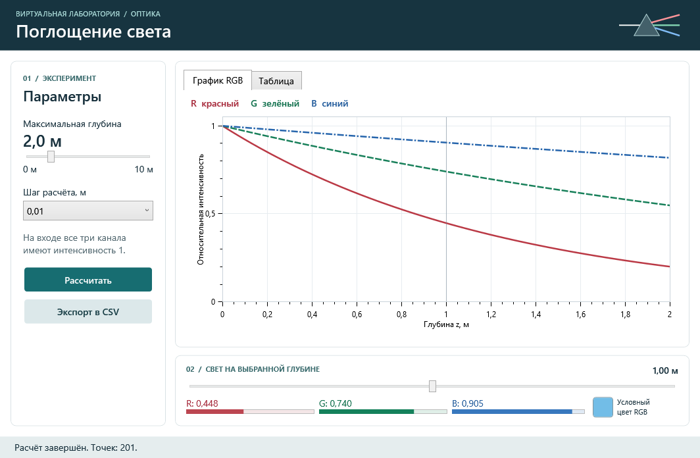

# Поглощение света: Windows-интерфейс

Приложение WPF на .NET 8 отображает поглощение красного, зелёного и синего каналов. Расчёт выполняет `EulerSolver` из Core. Начальное состояние: белый свет, R = G = B = 1.



## Запуск без Visual Studio

На Windows с .NET 8 SDK из корня репозитория:

```powershell
dotnet run --project UI/Light-absorption.UI -c Release
```

Чтобы подготовить папку для демонстрации на Windows x64 без установленной среды .NET:

```powershell
dotnet publish UI/Light-absorption.UI -c Release -r win-x64 --self-contained true -o artifacts/windows
```

Откройте `artifacts/windows/Light-absorption.UI.exe`. При переносе скопируйте **всю** папку.

## Проведение эксперимента

1. Выберите максимальную глубину от 0 до 10 м с интервалом 0,1 м и шаг расчёта. По умолчанию: 2 м и 0,01 м.
2. Нажмите «Рассчитать». График показывает три канала на общей шкале интенсивности; цвета и стили линий различаются.
3. Выберите глубину нижним ползунком или строкой во вкладке «Таблица». Пунктир на графике, индикаторы и условный образец RGB показывают одну и ту же точку. Перемещение ползунка не вызывает новый расчёт.
4. Нажмите «Экспорт в CSV» и укажите файл. Core запишет колонки `z,R,G,B` для всех отображённых точек. При изменении параметров экран сохраняет предыдущий результат, а экспорт отключается до пересчёта либо возврата к исходным настройкам.

При нулевой глубине ожидается одна точка: все каналы равны 1. На положительной глубине красный канал ослабевает быстрее синего. Образец RGB иллюстрирует относительные интенсивности; он не воспроизводит измеренный спектр.

## Устройство UI

`MainWindow.xaml` привязан к `MainViewModel` через `DataContext`. Команды MVVM Toolkit вызывают сервис через интерфейс; расчёт и запись CSV выполняются вне потока окна. Диалог сохранения открывается в потоке интерфейса.

`CoreExperimentService` вызывает готовые `EulerSolver.Solve` и `CsvExporter.ExportToCsv`. Если при накоплении шага Core возвращает дополнительную точку за заданной глубиной, UI исключает её и для отображения, и для выгрузки. Значения интенсивности берутся непосредственно из истории Core.

## Проверка

```powershell
dotnet test Light-absorption.sln -c Release
dotnet run --project UI/Light-absorption.UI.Smoke -c Release
```

Вторая команда запускает настоящее WPF-окно за пределами видимой области, нажимает кнопки и проверяет привязки, график, выбор точки, нулевую глубину, блокировку устаревшего экспорта и содержимое CSV. Подменяется только диалог выбора пути; физическая модель и запись файла настоящие.
